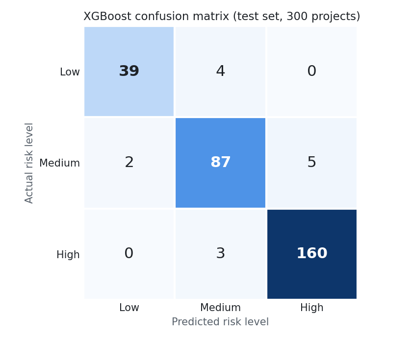

# Predicting Construction Project Risk Level

Can project data tell us which construction projects are Low, Medium or High risk? An XGBoost model puts **95.3% of test projects** in the right risk level. Always guessing "High" gets 54.3%.




## At a glance

| | |
|---|---|
| **Problem** | Classify construction projects into Low, Medium or High risk |
| **Data** | 1,000 projects, 28 columns. Start dates 2020-01-01 to 2022-09-26. Source: [BIM-AI Integrated Dataset](https://www.kaggle.com/datasets/ziya07/bim-ai-integrated-dataset) (Kaggle) |
| **Tools** | Python (pandas, NumPy, scikit-learn, XGBoost, LightGBM, Matplotlib, seaborn), Jupyter |
| **Methods** | Data cleaning, descriptive statistics, correlation analysis, feature engineering, classification (Random Forest, XGBoost, LightGBM, SVM), grid search with 5-fold cross-validation |
| **Key result** | XGBoost: 95.3% accuracy, macro F1 0.943, ROC-AUC 0.991 on 300 held-out projects |

## Key findings

- **Most projects ran late.** 830 of 1,000 projects (83%) took longer than planned. The median project ran 84 days over.
- **Most projects went over budget.** 836 of 1,000 (84%) cost more than planned. The median overrun was 19%.
- **Being late does not mean being "high risk".** The share of late projects is almost the same at every risk level: 84% for Low, 83% for Medium, 83% for High.
- **Safety score drives the risk label.** The average safety risk score is 1.9 for Low-risk projects, 3.8 for Medium and 7.5 for High. It is the model's most used feature by a wide margin.
- **The model never mixes up the extremes.** On 300 test projects it did not label a single High-risk project as Low, or a Low-risk project as High.

## Approach

**Cleaning** ([construction_delays.ipynb](construction_delays.ipynb))
- Checked all 1,000 rows: 0 missing values, 0 duplicate rows, 0 duplicate project IDs. No rows were removed.
- Converted 2 date columns (Start_Date, End_Date) from text to dates.
- Plotted distributions, box plots for outliers and a correlation heatmap for the numeric columns.

**Feature engineering** ([construction_eda.ipynb](construction_eda.ipynb))
- Added date features (start year, month, week, day of week, season).
- Added cost and schedule ratios: cost overrun %, cost per day, duration ratio, duration difference, a behind-schedule flag.
- Added safety, progress, structural, energy and weather indices.
- One-hot encoded project type, season and weather. Mapped Risk_Level to 0/1/2 as the target.
- Dropped project ID, raw dates and helper columns. Result: [data/clean_data.csv](data/clean_data.csv), 1,000 rows, 48 features plus the target.

**Modelling** ([construction_ml.ipynb](construction_ml.ipynb))
- 70/30 train/test split (700 / 300 projects), `random_state=42`.
- Trained Random Forest, XGBoost, LightGBM and SVM on the same split.
- Tuned Random Forest with a grid search (36 settings, 5-fold cross-validation). Best cross-validation accuracy: 0.927.
- Compared each model to a baseline that always predicts the most common class (High).

## Results

Test set: 300 projects (43 Low, 94 Medium, 163 High). Precision, recall and F1 are macro averages across the three classes. ROC-AUC is one-vs-rest, macro average.

| Model | Accuracy | Precision | Recall | F1 | ROC-AUC |
|---|---|---|---|---|---|
| **XGBoost** | **0.953** | **0.949** | **0.938** | **0.943** | **0.991** |
| LightGBM | 0.950 | 0.945 | 0.930 | 0.937 | 0.990 |
| Random Forest (100 trees) | 0.920 | 0.924 | 0.882 | 0.898 | 0.983 |
| Random Forest (200 trees, depth 20) | 0.917 | 0.920 | 0.868 | 0.888 | 0.985 |
| SVM (RBF) | 0.543 | 0.181 | 0.333 | 0.235 | 0.525 |
| Baseline: always "High" | 0.543 | n/a | n/a | n/a | n/a |

**What the confusion matrix means in practice (XGBoost)**
- **Missed High-risk projects:** 3 of 163 (2%) were labelled Medium. None were labelled Low.
- **False alarms:** 5 of the 165 projects flagged High were actually Medium.
- **Low-risk projects** are the hardest class: 39 of 43 found (91% recall). The other 4 were labelled Medium.

The SVM predicted "High" for every project, so it scores the same as the baseline. It was trained on unscaled features, which SVMs handle poorly.

## Limitations and next steps

- **This predicts risk level, not delay.** The target is the dataset's Risk_Level column. As shown above, it is not linked to whether a project ran late.
- **Some features are only known after a project ends** (actual cost, actual duration, schedule deviation, completion %). The model is not an early-warning tool as it stands.
- **The data may be synthetic.** Risk levels split cleanly on the safety score (no Low-risk project scores above 2.9). Results on real project data would likely be lower.
- **One train/test split.** XGBoost and LightGBM were not tuned or cross-validated.
- **Pipeline gaps.** The extra features made in `construction_ml.ipynb` (cell 5) are never used, because the data is not re-split afterwards. No notebook writes `data/clean_data.csv`. The current `engineer_features()` would also add 4 location columns.

Next steps:
- Build a true delay model: target = finished late (yes/no), using only information available at project start.
- Use cross-validation for all models. Scale features before the SVM.
- Save `clean_data.csv` from the notebook.

## How to reproduce

Tested with Python 3.14.0.

```bash
git clone https://github.com/cabasoah/Predicting-Construction-Delay---Data-Analytics-semester-project-.git
cd Predicting-Construction-Delay---Data-Analytics-semester-project-
python -m venv .venv
.venv\Scripts\activate          # Windows; use: source .venv/bin/activate on macOS/Linux
pip install -r requirements.txt
python evaluate.py               # prints the Results table and saves the confusion matrix image
jupyter notebook                 # optional: open the notebooks
```

`evaluate.py` uses the same data, split and model settings as `construction_ml.ipynb`. It reproduces every number in the Results table.

The notebooks, in order:
1. `construction_delays.ipynb`: cleaning and first look at the data
2. `construction_eda.ipynb`: exploratory analysis and feature engineering
3. `construction_ml.ipynb`: model training and comparison (reads `data/clean_data.csv`)

## Repo structure

```
.
├── data/
│   ├── constructions.csv          # raw data, 1,000 projects x 28 columns
│   └── clean_data.csv             # engineered features used by the model
├── construction_delays.ipynb      # cleaning and first look at the data
├── construction_eda.ipynb         # EDA and feature engineering
├── construction_ml.ipynb          # models, tuning, comparison
├── evaluate.py                    # full test-set metrics and confusion matrix image
├── requirements.txt
├── confusion_matrix_xgboost.png   # XGBoost confusion matrix (test set)
├── chart2.png                     # XGBoost feature importance
└── README.md
```
